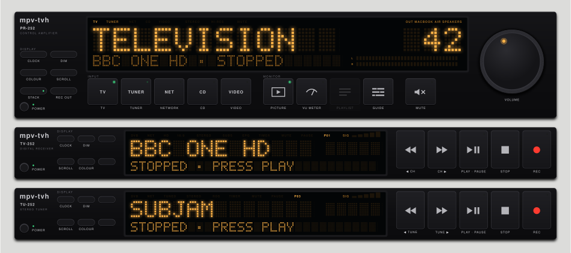
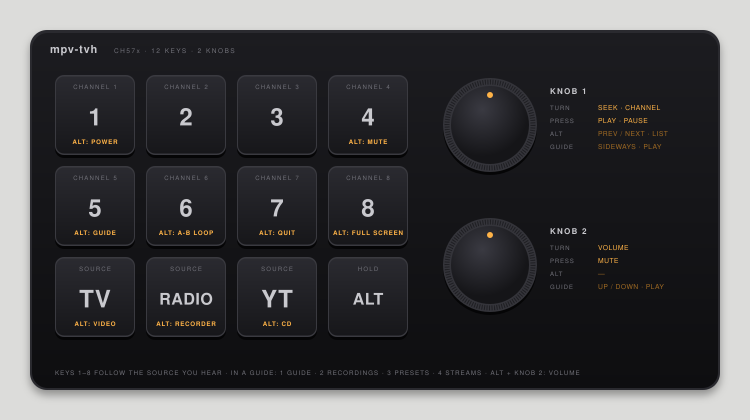
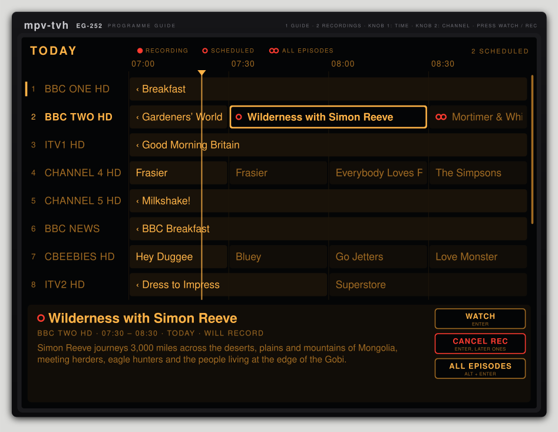

# mpv-tvh

A hi-fi stack on my Mac for live TV, radio, YouTube, music and video. It's all played by
[mpv](https://mpv.io) and driven from a cheap 12-key macro pad.



## How it got here

mpv-tvh started as a handful of `mpv` commands I ran in a terminal to watch live TV from my
[Tvheadend](https://tvheadend.org) server. Typing out stream URLs gets old quickly, so I wrapped
them in some [fish](https://fishshell.com) functions. That hid the messy parts and let me play a
known TV or radio channel by name: `tv bbc1`, `radio atlantic252`.

Next came Apple Shortcuts, so I could launch those functions without opening a terminal. Then I
wanted to flick between channels while watching a live stream, and the answer to that was a macro
pad. Shortcuts couldn't do what I wanted with it, so I dropped them and moved everything over to
[Hammerspoon](https://www.hammerspoon.org).

Last came the control interface. Each source has its own faceplate that looks like an old piece
of hi-fi gear, drawn by mpv itself, and a preamp sits on top and chooses what you hear. When
the stack switches on, the TV and radio wait, stopped, on their usual channel and station until
you press PLAY.

## What it does

- Play and record live TV channels
- Browse the TV guide and have Tvheadend record a programme, or every episode
- See what's recording, scheduled and recorded, watch recordings and delete them
- Play and record live radio stations
- Stream YouTube videos, saving each one you play as an MP4 (AUTO SAVE, on by default)
- Play locally stored music files, like an old-fashioned CD player
- Play locally stored videos
- Record the audio from any of the mpv-tvh sources

Each one has its own unit in the stack:

| Unit | What it is |
|---|---|
| PR-252 | The preamp: picks the source, shows the volume and output, opens the VU meters, playlists and libraries |
| TV-252 | Live TV, with now and next from the Tvheadend guide |
| EG-252 | The TV and radio guides: a week of listings, recording, your Tvheadend recordings, and presets |
| TU-252 | The radio tuner, with now and next for Tvheadend stations; its VU meter takes the TV picture's place |
| NP-252 | YouTube: copy a link, then click the faceplate; AUTO SAVE keeps a copy of each video |
| CD-252 | Your music folder, with a library browser and a playlist |
| DV-252 | Videos and recordings, picking up where you left off |
| RC-252 | The recorder: records whatever the preamp's REC OUT is set to |

## Install

You'll need macOS and [Homebrew](https://brew.sh). Live TV and radio need a Tvheadend server.
Internet radio streams and everything else work without one.

1. Install what it runs on:

   ```sh
   brew install mpv fish yq jq yt-dlp ffmpeg
   brew install --cask hammerspoon
   ```

   `yq` has to be mikefarah's version (the Homebrew one), not the Python wrapper.

2. Clone the repo and run the installer:

   ```sh
   git clone https://github.com/indigobravo/mpv-tvh.git
   cd mpv-tvh
   ./install.fish
   ```

   This symlinks the fish functions, the mpv config and scripts, and the Hammerspoon config into
   place. Anything already there is moved to `~/mpv-tvh-backup/` first. It's safe to run again
   after a `git pull`.

3. Switch it on with `preamp`. Without a config it starts as a demo: the TV shows test cards,
   the radio plays internet stations (BBC World Service, SomaFM, Radio Paradise) and YouTube a
   live stream.

4. Press **SETUP** on the preamp to connect your Tvheadend server. Type its address, or press
   FIND to look for it on your network, then CONNECT. The guide then lists every channel on the
   server so you can pick presets: up to eight TV channels and eight radio stations, one for each
   pad key. From then on the demo's gone: without a config, mpv-tvh uses
   `examples/defaults.yml` (the same layout, no demo channels) and your presets. That's all the
   TV and radio need, so you can skip the config file in step 5. See
   [Presets and SETUP](#presets-and-setup).

5. Or create a config, for internet radio stations, your own window positions and the rest:

   ```sh
   mkdir -p ~/.config/mpv-tvh
   cp examples/config.yml ~/.config/mpv-tvh/config.yml
   ```

   Add your Tvheadend host and your channels. `examples/config.yml` explains every setting,
   including how to list your Tvheadend channel UUIDs. A minimal one looks like this:

   ```yaml
   tvheadend:
     host: 192.168.0.10:9981

   tv:
     default: bbc1                    # the channel it starts on, stopped
     # start: bbc1                    # or play this one straight away
     channels:
       - name: bbc1                   # what you type: tv bbc1
         title: BBC ONE HD            # what the display shows
         uuid: "0123456789abcdef0123456789abcdef"   # a Tvheadend channel
       - name: atlantic252
         url: https://stream4.themediasite.co.uk:8042/   # or an internet stream
   ```

   Window positions are set with `--geometry` in each section. The example is laid out for a
   MacBook Air screen.

6. Open Hammerspoon, give it Accessibility access when it asks, and turn on *Launch Hammerspoon
   at login*.

   If your Tvheadend needs a login to set up recordings, put it in `~/.netrc` (and
   `chmod 600 ~/.netrc`); the guide uses it. Watching a recording streams it with mpv, which
   doesn't read `~/.netrc`, so that needs Tvheadend to allow streaming without a login:

   ```
   machine 192.168.0.10 login me password secret
   ```

7. Try it from a terminal: `preamp` switches the whole stack on. `tv bbc1`, `radio --default`,
   `youtube`, `music`, `video` and `recorder` each work on their own too.

## Macropad

The pad is one of the CH57x 12-key, 2-knob pads that turn up on Amazon and AliExpress under
various names. It's programmed with
[ch57x-keyboard-tool](https://github.com/kriomant/ch57x-keyboard-tool) using the layout in
`macropad/function_pad.yml`:

```sh
cargo install ch57x-keyboard-tool
ch57x-keyboard-tool upload macropad/function_pad.yml
```

Keys 1–8 send F13–F20, and the bottom row and the knobs send ctrl-alt-cmd chords (knob 2's
press too). Hammerspoon does the rest, so the knobs can do different things in the guide and
libraries without getting mixed up with the arrow keys.



**The bottom row picks the source.** If the preamp is off, a source key switches it on with
that source. If it's on, the key switches the preamp to that source and brings its faceplate to
the front. Press it again to mute or unmute.

| Key | Source | With Alt |
|---|---|---|
| TV | TV | Video player |
| Radio | Radio | Recorder: start it, then REC / STOP |
| YT | YouTube | CD player |

Alt + 1 is POWER: it switches the whole stack on (TV and radio start, on TV) or off. The TV and
radio start stopped on their `default` channel and station, so nothing plays until you press
PLAY. Give them a `start:` channel in the config to have it play straight away.

**Keys 1–8 follow the source you're listening to** while one of the mpv-tvh windows is in front:

| Key | Does | With Alt |
|---|---|---|
| 1–8 | Channel 1–8, or the track in that place in the CD or video queue | |
| 4 | | Mute this player |
| 5 | | Open or close the TV guide, or the CD or video library (other sources: screenshot) |
| 6 | | A-B loop |
| 7 | | Quit |
| 8 | | Full screen |

**Outside mpv-tvh**, keys 1–8 are everyday shortcuts: lock screen, previous / next tab, mute the
microphone, screenshot an area to the clipboard, reopen a closed tab, close a tab, and move a
window to the other display (Alt: maximise / restore).

A few quirks:

- **Alt + 2 / 3** open Display settings, because macOS treats F14 and F15 as brightness keys.
  Untick *Decrease / Increase display brightness* in System Settings → Keyboard → Keyboard
  Shortcuts → Display to let plain 2 and 3 through.
- **Alt + YT:** the YT key's chord already includes Option, so Hammerspoon watches for Alt being
  held on its own just before. Hold Alt for a moment before pressing YT.

## The guide, the libraries and the playlists



These open directly under the stack, the faceplates' width, and run down to the bottom of the
screen, so the taller your screen the more you see. They share a look: big text in one display,
the selection outlined, and touch-style buttons in the display.

**The TV and radio guides** open from the TV's or radio's display, GUIDE on the preamp, or Alt + 5.
The radio's works the same way, for its stations:

- Knob 1 moves through a channel's programmes; knob 2 changes channel.
- Press either knob to watch what's on now, or to record a later programme. Alt + press records
  every episode. Press again to cancel.
- Key 2 shows your recordings: what's recording and scheduled first, then what's been recorded.
  Press a knob to watch one in the video player. DELETE (pressed twice) removes it from
  Tvheadend; CANCEL REC, STOP REC and CANCEL ALL do what they say.
- Key 3 shows the presets and key 4 your streams (below). Key 1 goes back to the guide.

**The CD and video libraries** open from LIBRARY on the preamp, or Alt + 5:

- Knob 1 changes column; knob 2 moves up and down.
- Pressing either knob, or clicking an album, plays it. A track plays the same way, or with a
  double-click. A folder of folders opens.
- Type to jump to a name; `/` searches the whole library.
- PLAY NOW, PLAY NEXT, ADD and ADD ALL put things in the queue.

**The playlists** (CD and YouTube, from PLAYLIST on the preamp) show the queue with what's
playing lit. Double-click to play, drag to move, × to remove, CLEAR for all but what's playing.
Drop music files or folders, or YouTube links, on the window to add them.

In all of them, Alt + knob 2 is still the volume.

## Presets and SETUP

**SETUP** on the preamp opens the TV's guide at its SETUP page: type your Tvheadend server's
address (`tvheadend.local`, or an IP address; `:9981` is added if you leave the port off), or
press FIND to look for it on your network, then CONNECT. The first time, the guide goes straight
on to the presets.

**Presets** (key 3 in either guide) list every channel on the server. Knob 1 steps through the
filters: ALL, HD, SD, UHD and RADIO, from the type Tvheadend gives each service, then any channel
tags you've made in Tvheadend (Favourites, say). Knob 2 moves through the channels, and pressing
a knob puts the selected one on the next free pad key, or takes it off. RADIO's are the radio's
keys; the rest are the TV's. CLEAR KEYS (pressed twice) empties them.

**Streams** (key 4 in either guide) are internet radio and TV links you keep: copy a stream's
link, then press a knob (or ADD LINK) to add it. mpv-tvh checks it, names it from the station
where the stream says its name, and makes it TV if it has a picture, radio if not. Type to rename
the one selected; knob 1 switches it between TV and radio; REMOVE (pressed twice) deletes it.
Streams then show up in the presets with Tvheadend's channels, to put on a key. They work
without Tvheadend too. YouTube links go on the YouTube faceplate instead.

The TV and radio pick up the new channels when you leave the presets or streams, or close the guide, without
stopping what's playing if it's still there. The guide's rows follow the keys too.

The address and presets are kept in `~/.config/mpv-tvh/presets.json`, and win over the config's
Tvheadend address and channels, and the streams too. Internet stations in the config stay, after the presets. Without
a config, the demo is used until SETUP has saved an address, and `examples/defaults.yml` after
that. Delete `presets.json` to start again.

mpv-tvh doesn't log in to Tvheadend for this yet: set Tvheadend to allow your network without a
login.

## YouTube downloads

With AUTO SAVE on (the default; it's the SAVE key on the YouTube faceplate), every video you play
is downloaded in the background to the YouTube folder in your recordings, one at a time. They're
MP4 files with H.264 video and AAC sound where YouTube has them (up to 1080p), so QuickTime,
Photos and iPhones open them. A video is never downloaded twice, and live streams are skipped.

## Licence

See [LICENSE](LICENSE).
