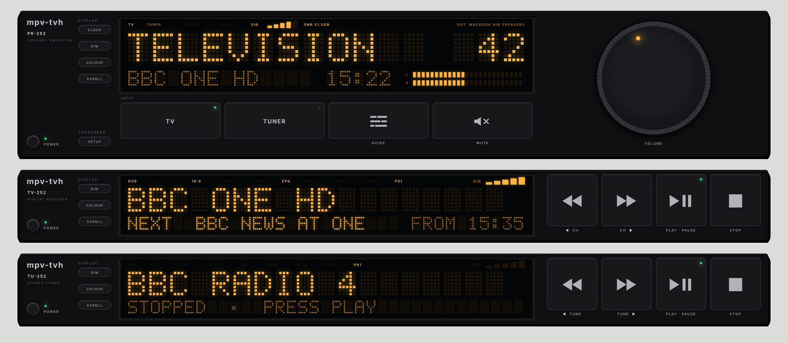

# mpv-tvh

A [Tvheadend](https://tvheadend.org) client for the Mac, for live TV and radio. It's played by
[mpv](https://mpv.io), and is driven from a cheap 12-key macro pad.



## What it does

- Watch live TV and listen to live radio from your Tvheadend server, or internet streams
- Switch between them instantly: both stay tuned, and the preamp picks which one you hear
- Browse a week of listings and have Tvheadend record a programme, or every episode
- Watch, stop and delete your Tvheadend recordings
- See the tuner's signal strength and SNR on the preamp
- Pick your channels from the server with presets: eight TV and eight radio, one per pad key

It's four units:

| Unit | What it is |
|---|---|
| PR-252 | The preamp: picks TV or radio, shows the volume, signal and output, opens the guide |
| TV-252 | Live TV, with now and next from the Tvheadend guide |
| TU-252 | The radio tuner, with now and next for Tvheadend stations |
| EG-252 | The TV and radio guides: listings, recording, your recordings, presets and SETUP |

## Quick start

You'll need macOS, [Homebrew](https://brew.sh) and a Tvheadend server.

```sh
brew install mpv fish jq ffmpeg
brew install --cask hammerspoon
git clone https://github.com/indigobravo/mpv-tvh.git
cd mpv-tvh
./install.fish
preamp
```

The first time, it asks for your Tvheadend server, or you can press DEMO to try it with test cards
and internet radio first. Once it's connected, pick your channels. See [Install](docs/install.md) for the
details.

## Docs

- [Install](docs/install.md): what it needs, the installer, Hammerspoon and logins
- [Configuration](docs/configuration.md): `config.json`, window positions, the demo and defaults
- [The preamp and faceplates](docs/preamp.md): the buttons, the display and the signal meter
- [The guide](docs/guide.md): listings, recording, recordings, presets, streams and SETUP
- [The macro pad](docs/macropad.md): the pad, flashing it, and what every key and knob does

Earlier versions also had YouTube, CD, video and recorder units. They're in the first commit,
and may come back as their own project.

## Licence

See [LICENSE](LICENSE).
