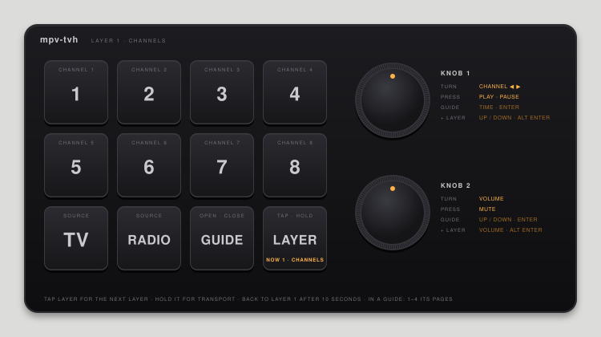
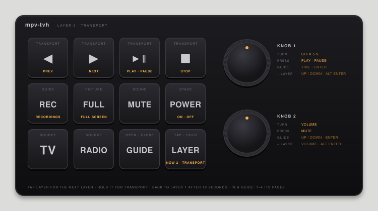
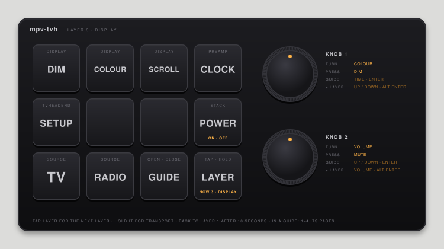

# The macro pad

[← README](../README.md)

The pad is one of the CH57x 12-key, 2-knob pads that turn up on Amazon and AliExpress under
various names. Keys 1–8 have three layers, and the preamp shows which one you're on.

## Flashing it

It's programmed with [ch57x-keyboard-tool](https://github.com/kriomant/ch57x-keyboard-tool)
using the layout in `macropad/function_pad.yml`:

```sh
cargo install ch57x-keyboard-tool
ch57x-keyboard-tool upload macropad/function_pad.yml
```

Keys 1–8 send F13–F20, and the bottom row and the knobs send ctrl-alt-cmd chords. Hammerspoon
(`hammerspoon/mpv-tvh.lua`) does the rest: the layers are its, not the pad's, so it always knows
which one you're on.

## The bottom row

| Key | Does |
|---|---|
| TV | Choose the TV |
| Radio | Choose the radio |
| Guide | Open or close the chosen source's guide |
| Layer | Tap: the next layer. Hold: layer 2 for the keys you press meanwhile |

If the preamp is off, TV, Radio or Guide switches it on. If it's on, TV or Radio chooses that
source and brings its faceplate to the front; press it again to mute or unmute.

## The layers

Tap LAYER to go 1 → 2 → 3 → 1. The preamp lights **PAD** and **CH**, **TRANS** or **DISP**,
and says the layer's name as it changes. After 10 seconds without the pad, it goes back to
layer 1. Hold LAYER and press a key to use layer 2 just for that press: a quick STOP or PLAY
while you're on the channels.

Layers 2 and 3 work whatever's in front, while the preamp's on. Layer 1's channel keys only go
to mpv-tvh while one of its windows is in front; elsewhere they're yours (below).

### 1 · Channels



Keys 1–8 are the channel presets, for the TV or the radio, whichever you're listening to.

### 2 · Transport



| Key | Does |
|---|---|
| 1 ◀ | The channel before (in a recording: back 30 seconds) |
| 2 ▶ | The channel after (in a recording: on 30 seconds) |
| 3 ▶‖ | Play, pause (after STOP: play) |
| 4 ■ | Stop |
| 5 REC | The guide, on its recordings |
| 6 FULL | The TV picture full screen |
| 7 MUTE | Mute the Mac |
| 8 POWER | Switch everything off (or on) |

Keys 1–4 are the faceplate's transport keys, in the same order.

### 3 · Display



| Key | Does |
|---|---|
| 1 DIM | Dim the displays |
| 2 COLOUR | The faceplates' next display colour (the preamp follows it) |
| 3 SCROLL | When long text scrolls: AUTO, OFF, ON |
| 4 CLOCK | The preamp's clock |
| 5 SETUP | Tvheadend's address and the presets, in the guide |
| 8 POWER | Switch everything off (or on) |

DIM, COLOUR and SCROLL change the preamp and both faceplates together, so they match.

## The knobs

| | Knob 1 | Knob 2 |
|---|---|---|
| Turn | Layer 1: channel (another app in front: up / down). Layer 2: seek 5 seconds. Layer 3: colour | Volume |
| Press | Play · pause (layer 3: DIM) | Mute |
| In a guide | Through time (or a page's columns); press to watch or record | Up and down; press as knob 1 |
| In a guide, LAYER held | Up and down; press: Alt + Enter (all episodes) | Volume; press as knob 1 |

## In the guide

Keys 1–4 switch the guide's pages, whatever the layer: **1** the guide, **2** recordings, **3**
presets, **4** streams.

## Your own keys

Outside mpv-tvh, on layer 1, keys 1–8 are yours: bind F13–F20 in `~/.hammerspoon/init.lua`. Have
them stand aside while mpv's in front and while the pad's on layer 2 or 3:

```lua
local tvh = require("mpv-tvh")
local pad = hs.hotkey.modal.new()
pad:bind({}, "f13", hs.caffeinate.lockScreen)       -- and so on

local function follow(app)
  if tvh.isMpv(app) or tvh.layered() then pad:exit() else pad:enter() end
end
padWatcher = hs.application.watcher.new(function(_, event, app)   -- global, so it lasts
  if event == hs.application.watcher.activated then follow(app) end
end):start()
tvh.onLayerChange = function() follow(hs.application.frontmostApplication()) end
follow(hs.application.frontmostApplication())
```
